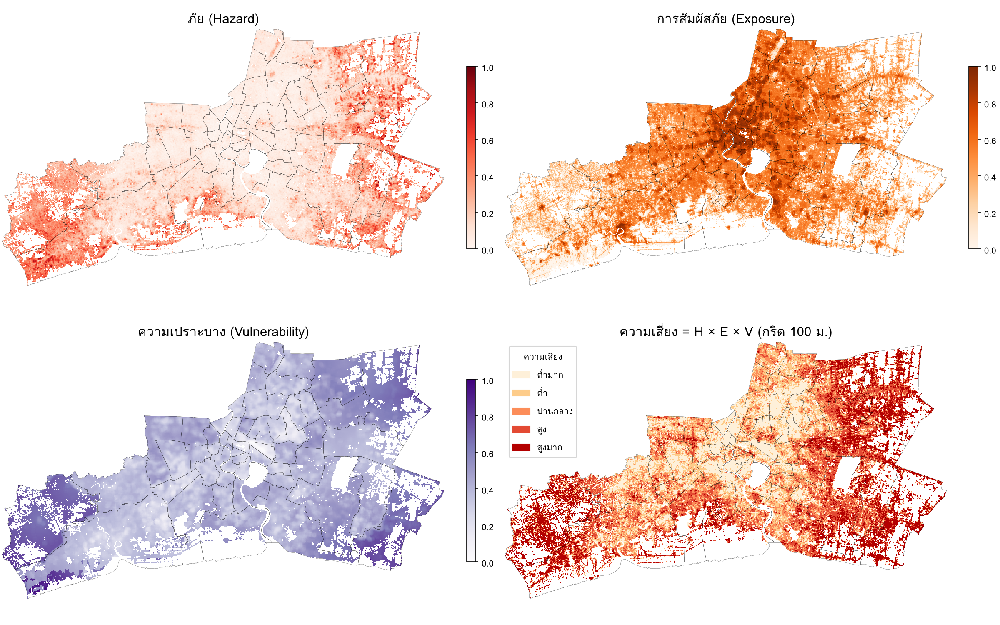
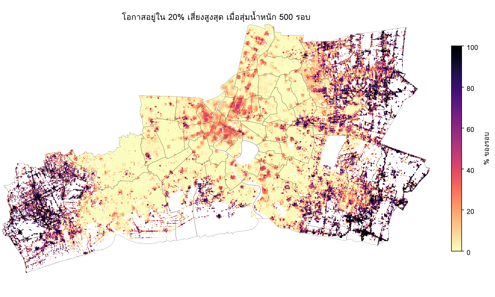

# ความเสี่ยงจากแผ่นดินทรุด และแนวทางจัดการภัย: กรุงเทพฯ สมุทรปราการ สมุทรสาคร

เอกสารนี้เชื่อมผลการวัดการทรุดตัวด้วย InSAR (Sentinel-1, เม.ย. 2564 – ต.ค. 2569) เข้ากับกรอบการจัดการภัยพิบัติของวิชา
ได้แก่ ภัย (hazard) การสัมผัสภัย (exposure) ความเปราะบาง (vulnerability) ความเสี่ยง (risk) และวงจรการจัดการภัย
(ป้องกัน บรรเทา เตรียมพร้อม ตอบสนอง ฟื้นฟู)

## 1. กรอบแนวคิด

**ความเสี่ยง = ภัย × การสัมผัสภัย × ความเปราะบาง** (UNDRR)

แผ่นดินทรุดเป็นภัยที่เกิดช้า (slow-onset) จึงไม่ค่อยสร้างความเสียหายครั้งเดียวรุนแรง แต่สะสมเป็นความเสียหายต่ออาคารและโครงสร้างพื้นฐาน
ทำให้ระบายน้ำได้ยากขึ้น และทำให้ภัยอื่นรุนแรงขึ้น โดยเฉพาะ**น้ำท่วม**และ**การกัดเซาะชายฝั่ง/น้ำทะเลหนุน** งานนี้จึงนับน้ำท่วมเป็นส่วนหนึ่งของภัยด้วย

| องค์ประกอบ | ตัวชี้วัด (ทุกช่องกริด 100 × 100 ม.) | แหล่งข้อมูล |
|---|---|---|
| ภัย (H) | อัตราทรุด (มม./ปี), angular distortion β (ค่าสูงสุดในช่อง), สัดส่วนน้ำท่วม 21 ต.ค. 2569 ในช่อง 3×3 รอบ ๆ | InSAR SBAS (`results/full`), `results/exposure_full/beta_full.tif`, `results/flood/flood_20261021.tif` |
| การสัมผัสภัย (E) | ประชากรในช่อง, พื้นที่หลังคาอาคารในช่อง, จำนวนสถานที่สำคัญในรัศมี 500 ม. | WorldPop 2025, Global Building Atlas, Overture Maps |
| ความเปราะบาง (V) | % ผู้สูงอายุ 65+, % เด็ก 0–4 ปี, % อาคารสูง ≤ 6 ม. (คิดในรัศมี 500 ม.), ระยะทางถึงโรงพยาบาลที่ใกล้ที่สุด | WorldPop 2025 age/sex, GBA, Overture Maps |

วิธีคำนวณ (`scripts/risk_raster.py`): ปรับตัวชี้วัดเป็น 0–1 ด้วย percentile 1–99 ของทั้งพื้นที่ (ตัวที่เป็นจำนวนนับใช้ log1p ก่อน)
เฉลี่ยเป็น H, E, V แล้วคูณกัน แบ่งช่องที่มีคนหรืออาคาร (2,467 ตร.กม.) เป็น 5 ระดับตาม quintile
ทดสอบความไวโดยสุ่มน้ำหนัก (Dirichlet) และวิธีรวม (คูณ/บวก) 500 รอบ ได้แผนที่ "โอกาสอยู่ใน 20% เสี่ยงสูงสุด"

ผลลัพธ์ (`results/risk_raster/`): `risk.tif`, `risk_class.tif` (0–4, 255 = ไม่มีคน/อาคาร), `H.tif`, `E.tif`, `V.tif`,
`ind_*.tif` (ตัวชี้วัดแต่ละตัว), `prob_top20.tif`, `risk_classes.csv`, `risk_raster_map.png`, `risk_raster_stability.png`
และชั้น "แผนที่ความเสี่ยง" บนเว็บ https://lnwhomeza.github.io/Natural-hazard/ (คลิกจุดใดก็ได้เพื่อดูระดับความเสี่ยงและค่า H/E/V ที่จุดนั้น)

(ฉบับรายเขตก่อนหน้า `scripts/risk.py` → `results/risk/` เก็บไว้เปรียบเทียบ)

## 2. ผลการประเมินความเสี่ยง

| ระดับ | พื้นที่ (ตร.กม.) | ประชากร | อาคาร | H เฉลี่ย | E เฉลี่ย | V เฉลี่ย |
|---|---|---|---|---|---|---|
| ต่ำมาก | 493 | 4.76 ล้าน | 769,800 | 0.06 | 0.50 | 0.33 |
| ต่ำ | 493 | 3.93 ล้าน | 727,100 | 0.10 | 0.49 | 0.39 |
| ปานกลาง | 493 | 3.25 ล้าน | 648,700 | 0.14 | 0.47 | 0.42 |
| สูง | 493 | 2.42 ล้าน | 561,000 | 0.20 | 0.45 | 0.46 |
| สูงมาก | 493 | 1.27 ล้าน | 478,800 | 0.34 | 0.41 | 0.57 |

พื้นที่ระดับ "สูงมาก" ที่มีคนอยู่มากที่สุด (นับประชากรในช่องระดับสูงมาก): ลาดกระบัง 188,000 คน, บางเสาธง 158,000, หนองจอก 138,000,
เมืองสมุทรสาคร 131,000, บางบ่อ 114,000, บางพลี 108,000, คลองสามวา 81,000, เมืองสมุทรปราการ 80,000, มีนบุรี 77,000, บ้านแพ้ว 55,000
(บ้านแพ้วมีพื้นที่ระดับสูงมากกว้างที่สุด 103 ตร.กม. แต่คนอยู่เบาบางกว่า)

ข้อสังเกตสำคัญ
- **ความเสี่ยงสูงกระจุกที่ชานเมืองด้านตะวันออก** (ลาดกระบัง หนองจอก คลองสามวา มีนบุรี บางพลี บางเสาธง บางบ่อ) และ**ตะวันตกเฉียงใต้** (บ้านแพ้ว เมืองสมุทรสาคร)
  ขณะที่เขตชั้นในของกรุงเทพฯ ซึ่งคนหนาแน่นที่สุด (E สูง) กลับเสี่ยงต่ำ เพราะการทรุดชะลอลงมากหลังควบคุมน้ำบาดาลตั้งแต่ทศวรรษ 2540
  ระดับที่สูงขึ้นจึงมี H และ V สูงขึ้นชัดเจน แต่ E เฉลี่ยลดลงเล็กน้อย
- แผนที่ raster แสดงความแตกต่าง**ภายใน**เขตที่การเฉลี่ยรายเขตมองไม่เห็น เช่น ชุมชนริมถนนและหมู่บ้านจัดสรรในลาดกระบัง/บางพลีเสี่ยงสูง
  ขณะที่บางส่วนของเขตเดียวกันเป็นนาข้าว/บ่อที่ไม่มีคน
- ความไว: ช่องระดับ "สูงมาก" 42% ยังอยู่ใน 20% บนสุดในอย่างน้อย 80% ของการสุ่มน้ำหนัก (แกนกลางที่มั่นคงคือชานเมืองตะวันออกและบ้านแพ้ว–เมืองสมุทรสาคร)
  ส่วนขอบของกลุ่มเปลี่ยนระดับได้ตามน้ำหนักที่เลือก ระดับช่องเดี่ยวจึงควรอ่านเป็นแนวโน้มของพื้นที่ ไม่ใช่ค่าแน่นอนรายหลังคาเรือน
- **หนองจอก ลาดกระบัง บางบ่อ** เป็นจุดที่ภัยสองอย่างซ้อนกัน คือทรุดเร็วและน้ำท่วมมากที่สุดในเหตุการณ์ ต.ค. 2569 (สัดส่วนพื้นที่ท่วมในพื้นที่ทรุด > 20 มม./ปี สูงกว่าพื้นที่ทรุดน้อยราว 27 เท่า, `results/flood/flood_by_subsidence.csv`)

## 3. แนวทางจัดการตามวงจรการจัดการภัย

### 3.1 ป้องกัน (Prevention): ลดตัวภัย H
| มาตรการ | พื้นที่เป้าหมาย | ผลที่วัดได้จากงานนี้ |
|---|---|---|
| ควบคุม/ลดการสูบน้ำบาดาล ปรับอัตราค่าใช้น้ำบาดาลและค่าอนุรักษ์ให้สูงกว่าน้ำประปา ขยายเขตประปาให้ครอบคลุมเพื่อทดแทน | บ้านแพ้ว บางบ่อ เมืองสมุทรสาคร บางเสาธง ลาดกระบัง (นิคมอุตสาหกรรม) | ติดตามว่าอัตราทรุดลดลงหรือไม่จาก InSAR รอบถัดไป |
| เติมน้ำใต้ดิน (managed aquifer recharge) ผ่านบ่อสังเกตการณ์/บ่อเติมน้ำในฤดูฝน | ชั้นน้ำบาดาลกรุงเทพฯ–พระประแดง–นครหลวง ในเขตทรุดเร็ว | — |
| ห้ามขุดบ่อบาดาลใหม่ในพื้นที่ทรุด > 10 มม./ปี (ประกาศเขตวิกฤตตามผลแผนที่) | ทุกเขตระดับ "สูง/สูงมาก" | แผนที่ `vlm_full` และชั้นความเสี่ยงบนเว็บใช้กำหนดขอบเขต |

### 3.2 บรรเทา (Mitigation): ลด E และ V
| มาตรการ | เป้าหมาย |
|---|---|
| ผังเมือง: จำกัดการขยายชุมชนหนาแน่นและสิ่งปลูกสร้างสำคัญในพื้นที่ β ≥ 1/3000 หรือทรุด > 20 มม./ปี | ลดการสัมผัสภัยในอนาคต (บ้านแพ้ว บางบ่อ) |
| มาตรฐานฐานรากบ้านแนวราบ: เสาเข็มยาวถึงชั้นทรายแข็ง ออกแบบรองรับทรุดต่างระดับ เชื่อมท่อ/ถนนแบบยืดหยุ่น | บ้านเตี้ย ≤ 6 ม. คือ 80–98% ของอาคารในเขตเสี่ยงสูงสุด |
| ตรวจสภาพสถานที่สำคัญที่อยู่บนพื้นที่ทรุดเร็ว (โรงเรียน โรงพยาบาล สถานีตำรวจ/ดับเพลิง) จัดลำดับตาม `facility_ranking.csv` | เมืองสมุทรสาคร (55 แห่งในพื้นที่ทรุด > 10) บ้านแพ้ว (34) บางบ่อ ลาดกระบัง (20) |
| ออกแบบระบบระบายน้ำ ประตูระบายน้ำ คันกั้นน้ำ เผื่อการทรุดสะสม (เช่น 10–20 ซม. ใน 10 ปี) | หนองจอก ลาดกระบัง บางบ่อ บางเสาธง |
| ปรับตัวชายฝั่ง: คันกั้นน้ำทะเล แนวไม้ไผ่/ป่าชายเลนชะลอคลื่น โดยคิดทั้งระดับน้ำทะเลขึ้นและการทรุด | พระสมุทรเจดีย์ บางขุนเทียน เมืองสมุทรปราการ เมืองสมุทรสาคร |

### 3.3 เตรียมพร้อม (Preparedness)
- **ระบบติดตาม**: ประมวลผล InSAR Sentinel-1 ปีละครั้ง (pipeline ในโครงการนี้ทำซ้ำได้) ผูกกับสถานี GNSS (เช่น CUSV) และหมุดระดับ
  ตั้งเกณฑ์เตือนเมื่ออัตราทรุดเร่งขึ้นหรือ β เกิน 1/3000 ใกล้สถานที่สำคัญ
- **สื่อสารความเสี่ยงต่อประชาชน**: เว็บแผนที่สาธารณะให้ตรวจอัตราทรุดและความเสี่ยงที่ตำแหน่งบ้านตนเอง ใช้ประกอบการซื้อ/สร้างบ้านและการต่อเติม
- **แผนเผชิญเหตุน้ำท่วมรายเขต**: ใช้แผนที่น้ำท่วมจากเรดาร์ (ภายใน 1–2 วันหลังดาวเทียมผ่าน) ร่วมกับชั้นความเสี่ยงระบุจุดที่ต้องเตรียมเครื่องสูบน้ำ จุดอพยพ
  และกลุ่มเปราะบาง (ผู้สูงอายุ เด็กเล็ก) ล่วงหน้า โดยเฉพาะหนองจอก บางบ่อ ที่โรงพยาบาลอยู่ไกล (ระยะเฉลี่ย 11–15 กม.)

### 3.4 ตอบสนอง (Response)
- ในเหตุการณ์น้ำท่วม จัดลำดับการสูบน้ำ/ช่วยเหลือตามแผนที่น้ำท่วมซ้อนกับความเปราะบาง (เช่น เหตุการณ์ 21 ต.ค. 2569: หนองจอก 41.9 ตร.กม., บางบ่อ 13.8, ลาดกระบัง 13.1)
- เปรียบเทียบกับแผนที่น้ำท่วมอัตโนมัติ (Copernicus GFM) เพื่อยืนยันพื้นที่ก่อนสั่งการ

### 3.5 ฟื้นฟู (Recovery)
- ซ่อมโครงสร้างพื้นฐานด้วยมาตรฐานที่รองรับการทรุด (build back better) เช่น ยกระดับถนน/ทางเท้าพร้อมท่อแบบยืดหยุ่น แทนการซ่อมแบบเดิม
- กองทุน/มาตรการช่วยเหลือการซ่อมบ้านแนวราบที่ร้าวจากการทรุดต่างระดับในพื้นที่ β สูง
- ทบทวนผังเมืองและเขตควบคุมน้ำบาดาลหลังเหตุการณ์ โดยใช้ผล InSAR ชุดใหม่

## 4. ข้อจำกัด
- ดัชนีเป็น**ความเสี่ยงเปรียบเทียบ**ภายในพื้นที่ศึกษา (percentile scaling, quintile) ไม่ใช่มูลค่าความเสียหายหรือความน่าจะเป็น
- ข้อมูลประชากรและอายุ 100 ม. เป็นการกระจายจากแบบจำลอง ค่าในช่องเดี่ยวจึงคลาดได้ ใช้รัศมี 500 ม. เพื่อลด noise
- ข้อมูลประชากรและโครงสร้างอายุเป็นค่าประมาณจากแบบจำลอง (WorldPop) รวมประชากรแฝง จึงสูงกว่าทะเบียนราษฎร์
- จำนวนโรงพยาบาลจาก Overture Maps (117 แห่ง) อาจขาดโรงพยาบาลขนาดเล็ก/คลินิก ทำให้ระยะทางถึงโรงพยาบาลในเขตรอบนอกสูงเกินจริง
- ไม่มีข้อมูลรายได้/ความยากจนและชนิดฐานรากจริงระดับอาคาร ความสูงอาคาร ≤ 6 ม. ใช้เป็นตัวแทนบ้านเสาเข็มสั้น
- น้ำท่วมจากเรดาร์ตรวจในเขตเมืองหนาแน่นได้ไม่ดี จึงอาจประเมินภัยน้ำท่วมในเขตชั้นในต่ำไป
- ช่องที่ไม่มีค่าอัตราทรุด (นาข้าว บ่อปลา แหล่งน้ำ ที่ InSAR วัดไม่ได้) ไม่ถูกประเมิน
