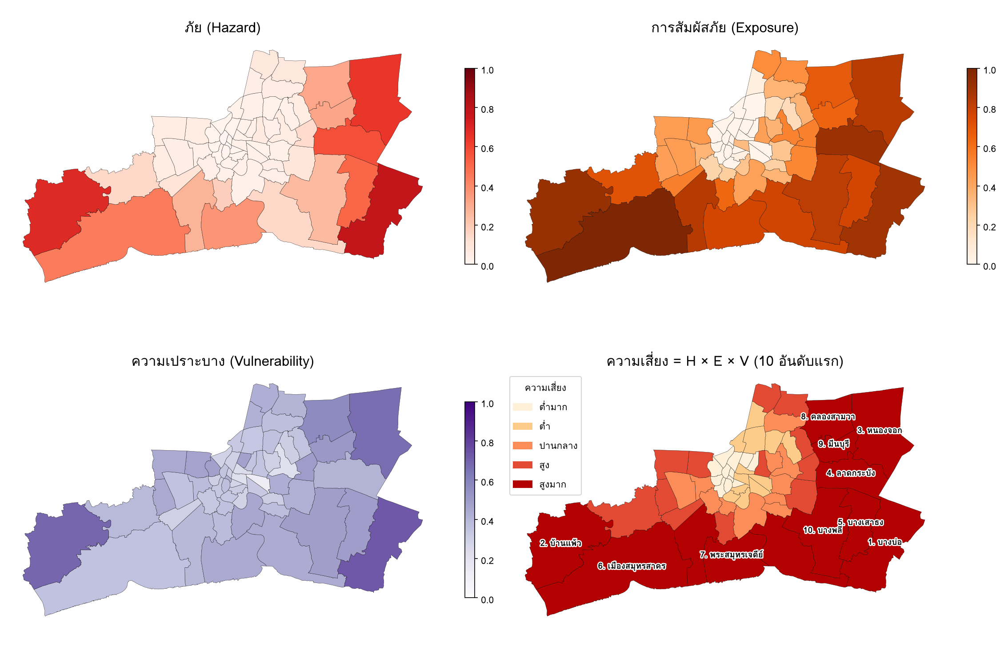

# ความเสี่ยงจากแผ่นดินทรุด และแนวทางจัดการภัย: กรุงเทพฯ สมุทรปราการ สมุทรสาคร

เอกสารนี้เชื่อมผลการวัดการทรุดตัวด้วย InSAR (Sentinel-1, เม.ย. 2564 – ต.ค. 2569) เข้ากับกรอบการจัดการภัยพิบัติของวิชา
ได้แก่ ภัย (hazard) การสัมผัสภัย (exposure) ความเปราะบาง (vulnerability) ความเสี่ยง (risk) และวงจรการจัดการภัย
(ป้องกัน บรรเทา เตรียมพร้อม ตอบสนอง ฟื้นฟู)

## 1. กรอบแนวคิด

**ความเสี่ยง = ภัย × การสัมผัสภัย × ความเปราะบาง** (UNDRR)

แผ่นดินทรุดเป็นภัยที่เกิดช้า (slow-onset) จึงไม่ค่อยสร้างความเสียหายครั้งเดียวรุนแรง แต่สะสมเป็นความเสียหายต่ออาคารและโครงสร้างพื้นฐาน
ทำให้ระบายน้ำได้ยากขึ้น และทำให้ภัยอื่นรุนแรงขึ้น โดยเฉพาะ**น้ำท่วม**และ**การกัดเซาะชายฝั่ง/น้ำทะเลหนุน** งานนี้จึงนับน้ำท่วมเป็นส่วนหนึ่งของภัยด้วย

| องค์ประกอบ | ตัวชี้วัด (รายเขต/อำเภอ, 59 หน่วย) | แหล่งข้อมูล |
|---|---|---|
| ภัย (H) | อัตราทรุดมัธยฐาน, % พื้นที่ทรุด > 10 มม./ปี, % พื้นที่ angular distortion β ≥ 1/3000, % พื้นที่น้ำท่วม 21 ต.ค. 2569 | InSAR SBAS (`results/full`), `results/exposure_full/beta_full.tif`, `results/flood` |
| การสัมผัสภัย (E) | ประชากร, อาคาร, สถานที่สำคัญ ในพื้นที่ทรุด > 10 มม./ปี | WorldPop 2025, Global Building Atlas, Overture Maps (`results/exposure_full`) |
| ความเปราะบาง (V) | % ผู้สูงอายุ 65+, % เด็ก 0–4 ปี, % อาคารสูง ≤ 6 ม., ระยะทางเฉลี่ย (ถ่วงประชากร) ถึงโรงพยาบาลที่ใกล้ที่สุด | WorldPop 2025 age/sex, GBA, Overture Maps |

วิธีคำนวณ (`scripts/risk.py`): ปรับตัวชี้วัดเป็น 0–1 แบบ min–max (ตัวที่เป็นจำนวนนับใช้ log ก่อน) เฉลี่ยเป็น H, E, V
แล้วคูณกัน แบ่ง 5 ระดับตาม quintile ทดสอบความไวโดยสุ่มน้ำหนัก (Dirichlet) และวิธีรวม (คูณ/บวก) 2,000 รอบ

ผลลัพธ์: `results/risk/risk_districts.csv`, `results/risk/risk_map.png`, `results/risk/risk_rank_uncertainty.png`
และชั้น "ดัชนีความเสี่ยงรายเขต" บนเว็บ https://lnwhomeza.github.io/Natural-hazard/

## 2. ผลการประเมินความเสี่ยง

| อันดับ | เขต/อำเภอ | ทรุด (มม./ปี) | % พื้นที่ทรุด > 10 | % น้ำท่วม | ประชากรในพื้นที่ทรุด > 10 | อาคาร | % ผู้สูงอายุ | H | E | V | % รอบที่ติด 10 อันดับแรก |
|---|---|---|---|---|---|---|---|---|---|---|---|
| 1 | บางบ่อ (สป.) | 17.6 | 92 | 8.1 | 123,000 | 70,400 | 15.0 | 0.78 | 0.89 | 0.73 | 100 |
| 2 | บ้านแพ้ว (สค.) | 23.1 | 98 | 1.0 | 69,000 | 68,200 | 19.6 | 0.69 | 0.92 | 0.69 | 100 |
| 3 | หนองจอก (กทม.) | 11.2 | 61 | 18.1 | 118,000 | 57,700 | 10.5 | 0.64 | 0.83 | 0.67 | 100 |
| 4 | ลาดกระบัง (กทม.) | 12.1 | 66 | 10.6 | 272,000 | 55,000 | 7.4 | 0.57 | 0.91 | 0.41 | 100 |
| 5 | บางเสาธง (สป.) | 12.0 | 68 | 5.7 | 255,000 | 15,100 | 9.3 | 0.51 | 0.76 | 0.49 | 100 |
| 6 | เมืองสมุทรสาคร (สค.) | 13.2 | 62 | 2.4 | 301,000 | 77,200 | 6.6 | 0.44 | 1.00 | 0.35 | 99 |
| 7 | พระสมุทรเจดีย์ (สป.) | 10.9 | 56 | 1.9 | 38,000 | 27,400 | 11.8 | 0.37 | 0.76 | 0.44 | 99 |
| 8 | คลองสามวา (กทม.) | 8.9 | 37 | 5.1 | 70,000 | 21,900 | 8.8 | 0.31 | 0.68 | 0.56 | 94 |
| 9 | มีนบุรี (กทม.) | 9.2 | 41 | 5.6 | 72,000 | 19,600 | 9.1 | 0.31 | 0.65 | 0.52 | 60 |
| 10 | บางพลี (สป.) | 8.5 | 34 | 0.6 | 120,000 | 44,200 | 11.4 | 0.25 | 0.82 | 0.49 | 91 |
| 11 | บางขุนเทียน (กทม.) | 9.4 | 43 | 0.6 | 122,000 | 33,100 | 9.7 | 0.27 | 0.84 | 0.39 | 53 |

ข้อสังเกตสำคัญ
- **ความเสี่ยงกระจุกที่ขอบนอกด้านตะวันออกและตะวันตกเฉียงใต้** (แนวชานเมืองที่ยังใช้น้ำบาดาล นิคมอุตสาหกรรม บ่อปลา/นาข้าว)
  ขณะที่เขตชั้นในของกรุงเทพฯ ซึ่งคนหนาแน่นที่สุดกลับเสี่ยงต่ำ เพราะการทรุดชะลอลงมากหลังควบคุมน้ำบาดาลตั้งแต่ทศวรรษ 2540
- **อันดับแรก ๆ มั่นคง**: 7 อันดับแรกติด 10 อันดับแรกในการสุ่มน้ำหนักเกือบ 100% ของรอบ ส่วนอันดับ 9–11 (มีนบุรี บางพลี บางขุนเทียน) สลับกันได้ตามน้ำหนัก
- **ภัยกับการสัมผัสภัยสัมพันธ์กันสูง** (Spearman 0.95) เพราะใช้เกณฑ์ทรุด > 10 มม./ปี กำหนดว่าใครสัมผัสภัย ส่วนความเปราะบางให้ข้อมูลเพิ่ม (Spearman กับ H 0.58)
  ตัวอย่าง: บางบ่อ บ้านแพ้ว หนองจอก มี V สูง (บ้านแนวราบ > 90%, ผู้สูงอายุมาก, โรงพยาบาลไกล) ทำให้ขึ้นอันดับเหนือเมืองสมุทรสาครที่ E สูงสุด
- **หนองจอก ลาดกระบัง บางบ่อ** เป็นจุดที่ภัยสองอย่างซ้อนกัน คือทรุดเร็วและน้ำท่วมมากที่สุดในเหตุการณ์ ต.ค. 2569 (สัดส่วนพื้นที่ท่วมในพื้นที่ทรุด > 20 มม./ปี สูงกว่าพื้นที่ทรุดน้อยราว 27 เท่า, `results/flood/flood_by_subsidence.csv`)

## 3. แนวทางจัดการตามวงจรการจัดการภัย

### 3.1 ป้องกัน (Prevention): ลดตัวภัย H
| มาตรการ | พื้นที่เป้าหมาย | ผลที่วัดได้จากงานนี้ |
|---|---|---|
| ควบคุม/ลดการสูบน้ำบาดาล ปรับอัตราค่าใช้น้ำบาดาลและค่าอนุรักษ์ให้สูงกว่าน้ำประปา ขยายเขตประปาให้ครอบคลุมเพื่อทดแทน | บ้านแพ้ว บางบ่อ เมืองสมุทรสาคร บางเสาธง ลาดกระบัง (นิคมอุตสาหกรรม) | ติดตามว่าอัตราทรุดลดลงหรือไม่จาก InSAR รอบถัดไป |
| เติมน้ำใต้ดิน (managed aquifer recharge) ผ่านบ่อสังเกตการณ์/บ่อเติมน้ำในฤดูฝน | ชั้นน้ำบาดาลกรุงเทพฯ–พระประแดง–นครหลวง ในเขตทรุดเร็ว | — |
| ห้ามขุดบ่อบาดาลใหม่ในพื้นที่ทรุด > 10 มม./ปี (ประกาศเขตวิกฤตตามผลแผนที่) | ทุกเขตระดับ "สูง/สูงมาก" | แผนที่ `vlm_full` และชั้นความเสี่ยงบนเว็บใช้กำหนดขอบเขต |

### 3.2 บรรเทา (Mitigation): ลด E และ V
| มาตรการ | เป้าหมาย |
|---|---|
| ผังเมือง: จำกัดการขยายชุมชนหนาแน่นและสิ่งปลูกสร้างสำคัญในพื้นที่ β ≥ 1/3000 หรือทรุด > 20 มม./ปี | ลดการสัมผัสภัยในอนาคต (บ้านแพ้ว บางบ่อ) |
| มาตรฐานฐานรากบ้านแนวราบ: เสาเข็มยาวถึงชั้นทรายแข็ง ออกแบบรองรับทรุดต่างระดับ เชื่อมท่อ/ถนนแบบยืดหยุ่น | บ้านเตี้ย ≤ 6 ม. คือ 80–98% ของอาคารในเขตเสี่ยงสูงสุด |
| ตรวจสภาพสถานที่สำคัญที่อยู่บนพื้นที่ทรุดเร็ว (โรงเรียน โรงพยาบาล สถานีตำรวจ/ดับเพลิง) จัดลำดับตาม `facility_ranking.csv` | เมืองสมุทรสาคร (55 แห่งในพื้นที่ทรุด > 10) บ้านแพ้ว (34) บางบ่อ ลาดกระบัง (20) |
| ออกแบบระบบระบายน้ำ ประตูระบายน้ำ คันกั้นน้ำ เผื่อการทรุดสะสม (เช่น 10–20 ซม. ใน 10 ปี) | หนองจอก ลาดกระบัง บางบ่อ บางเสาธง |
| ปรับตัวชายฝั่ง: คันกั้นน้ำทะเล แนวไม้ไผ่/ป่าชายเลนชะลอคลื่น โดยคิดทั้งระดับน้ำทะเลขึ้นและการทรุด | พระสมุทรเจดีย์ บางขุนเทียน เมืองสมุทรปราการ เมืองสมุทรสาคร |

### 3.3 เตรียมพร้อม (Preparedness)
- **ระบบติดตาม**: ประมวลผล InSAR Sentinel-1 ปีละครั้ง (pipeline ในโครงการนี้ทำซ้ำได้) ผูกกับสถานี GNSS (เช่น CUSV) และหมุดระดับ
  ตั้งเกณฑ์เตือนเมื่ออัตราทรุดเร่งขึ้นหรือ β เกิน 1/3000 ใกล้สถานที่สำคัญ
- **สื่อสารความเสี่ยงต่อประชาชน**: เว็บแผนที่สาธารณะให้ตรวจอัตราทรุดและความเสี่ยงที่ตำแหน่งบ้านตนเอง ใช้ประกอบการซื้อ/สร้างบ้านและการต่อเติม
- **แผนเผชิญเหตุน้ำท่วมรายเขต**: ใช้แผนที่น้ำท่วมจากเรดาร์ (ภายใน 1–2 วันหลังดาวเทียมผ่าน) ร่วมกับชั้นความเสี่ยงระบุจุดที่ต้องเตรียมเครื่องสูบน้ำ จุดอพยพ
  และกลุ่มเปราะบาง (ผู้สูงอายุ เด็กเล็ก) ล่วงหน้า โดยเฉพาะหนองจอก บางบ่อ ที่โรงพยาบาลอยู่ไกล (ระยะเฉลี่ย 11–15 กม.)

### 3.4 ตอบสนอง (Response)
- ในเหตุการณ์น้ำท่วม จัดลำดับการสูบน้ำ/ช่วยเหลือตามแผนที่น้ำท่วมซ้อนกับความเปราะบาง (เช่น เหตุการณ์ 21 ต.ค. 2569: หนองจอก 41.9 ตร.กม., บางบ่อ 13.8, ลาดกระบัง 13.1)
- เปรียบเทียบกับแผนที่น้ำท่วมอัตโนมัติ (Copernicus GFM) เพื่อยืนยันพื้นที่ก่อนสั่งการ

### 3.5 ฟื้นฟู (Recovery)
- ซ่อมโครงสร้างพื้นฐานด้วยมาตรฐานที่รองรับการทรุด (build back better) เช่น ยกระดับถนน/ทางเท้าพร้อมท่อแบบยืดหยุ่น แทนการซ่อมแบบเดิม
- กองทุน/มาตรการช่วยเหลือการซ่อมบ้านแนวราบที่ร้าวจากการทรุดต่างระดับในพื้นที่ β สูง
- ทบทวนผังเมืองและเขตควบคุมน้ำบาดาลหลังเหตุการณ์ โดยใช้ผล InSAR ชุดใหม่

## 4. ข้อจำกัด
- ดัชนีเป็น**ความเสี่ยงเปรียบเทียบ**ระหว่าง 59 เขต (min–max, quintile) ไม่ใช่มูลค่าความเสียหายหรือความน่าจะเป็น
- ข้อมูลประชากรและโครงสร้างอายุเป็นค่าประมาณจากแบบจำลอง (WorldPop) รวมประชากรแฝง จึงสูงกว่าทะเบียนราษฎร์
- จำนวนโรงพยาบาลจาก Overture Maps (117 แห่ง) อาจขาดโรงพยาบาลขนาดเล็ก/คลินิก ทำให้ระยะทางถึงโรงพยาบาลในเขตรอบนอกสูงเกินจริง
- ไม่มีข้อมูลรายได้/ความยากจนและชนิดฐานรากจริงระดับอาคาร ความสูงอาคาร ≤ 6 ม. ใช้เป็นตัวแทนบ้านเสาเข็มสั้น
- น้ำท่วมจากเรดาร์ตรวจในเขตเมืองหนาแน่นได้ไม่ดี จึงอาจประเมินภัยน้ำท่วมในเขตชั้นในต่ำไป
- ภัยและการสัมผัสภัยใช้เกณฑ์ทรุด 10 มม./ปี ร่วมกัน จึงสัมพันธ์กันสูง ผลการสุ่มน้ำหนักช่วยแสดงว่าอันดับใดมั่นคง
