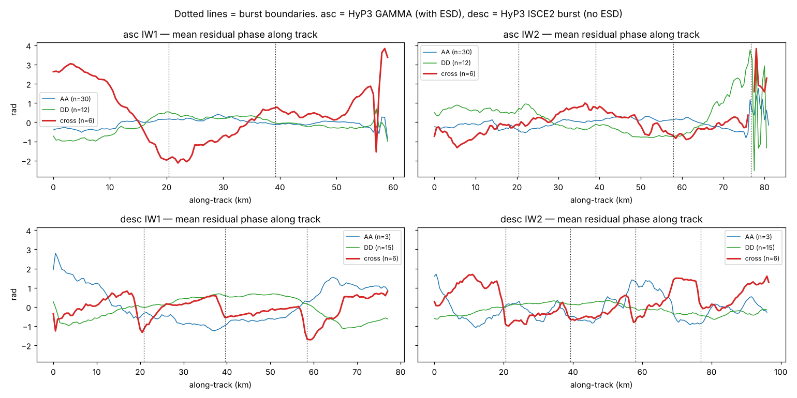
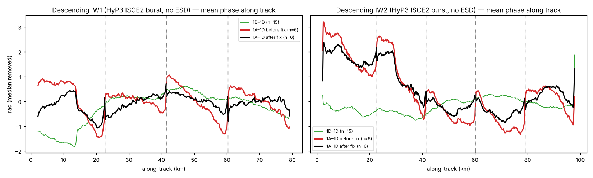

# Sentinel-1A → 1D: รอยต่อราย burst ใน interferogram ข้ามดาวเทียม

## สรุป
- IPF ของภาพ S1A ช่วงสุดท้ายและ S1D ช่วงแรกเป็นเวอร์ชันเดียวกัน (004.03) จึงไม่ใช่สาเหตุ
- **ascending (HyP3 INSAR_GAMMA, ใช้ ESD):** คู่ 1A–1D ไม่มีรอยต่อที่ขอบ burst (|รอยต่อเฉลี่ย| ≤ 0.13 rad เท่าคู่ดาวเทียมเดียวกัน)
- **descending (HyP3 INSAR_ISCE_MULTI_BURST, ไม่ใช้ ESD ตามคู่มือ HyP3):** คู่ 1A–1D มีรูปแบบฟันเลื่อย
  (ramp ภายใน burst + กระโดดที่ขอบ +1.1 ถึง +1.9 rad) สม่ำเสมอทุกคู่ = ภาพเหลื่อมแนว azimuth ~0.02–0.03 pixel
  คู่ 1A–1A และ 1D–1D ไม่มี



## วิธีแก้ (`scripts/sawtooth.py`)
ต่อ swath ต่อคู่: fit `φ = ระนาบ(along, cross) + s·(along − ศูนย์กลาง burst)` ลบเทอม s
แล้วจับคู่ค่าคงที่ราย burst จากรอยต่อในแถบ ±1.5 กม. รอยต่อจริงของไฟล์ ISCE เลื่อนจากกึ่งกลาง footprint ของ ASF
+1.34 กม. (`estimate_seam_shift`)

| desc (rad) | รอยต่อที่ขอบ burst | ความชันภายใน burst (rad/กม.) |
|---|---|---|
| 1D–1D (n=15) | 0.0 ถึง +0.2 | ~0.00 |
| 1A–1D ก่อนแก้ (n=6) | +1.1 ถึง +1.9 | −0.10 ถึง −0.12 |
| 1A–1D หลังแก้ (n=6) | +0.1 ถึง +0.3 | −0.01 ถึง −0.05 |



```python
from sawtooth import burst_geometry, estimate_seam_shift, fix_sawtooth
geom = burst_geometry(62, '2026-04-09', provinces)            # footprint ของ burst ใน track
shift = estimate_seam_shift(cross_pair_unw_paths, geom)       # ครั้งเดียวต่อ track
for p in cross_pair_unw_paths:                                # เฉพาะคู่ 1A–1D, ก่อนเข้า MintPy
    fix_sawtooth(p, geom, shift)
```

## หมายเหตุ
- S1A ยังถ่ายต่อถึง 20 มิ.ย. 2569 (desc) และ 28 มิ.ย. 2569 (asc) โดยมี burst ครบ ช่วง post แบบ S1A อย่างเดียวจึงยาวได้ ~15 เดือน
- อ้างอิง: คู่มือ HyP3 Burst InSAR ("The Enhanced Spectral Diversity (ESD) method is not used"), คู่มือ HyP3 InSAR (GAMMA ใช้ ESD),
  Yagüe-Martínez et al. (S1A/S1B cross-interferometry ต้องใช้ ESD)
