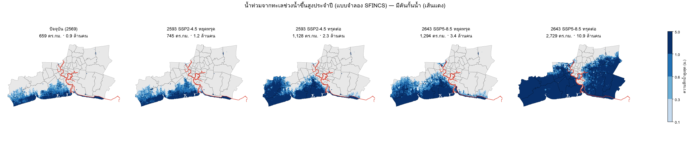
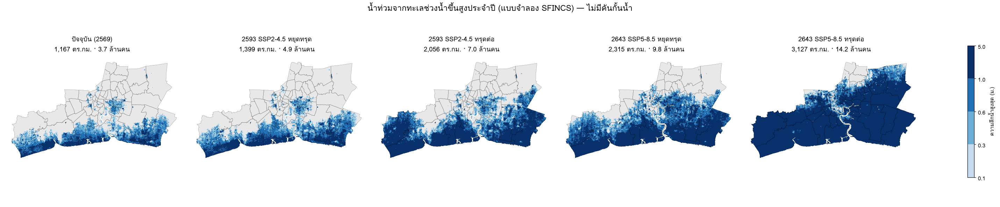

# น้ำท่วมจากทะเลด้วยแบบจำลองชลศาสตร์ SFINCS: ผลของการทรุดเทียบระดับน้ำทะเลที่สูงขึ้น

สคริปต์: `scripts/sfincs_flood.py` (build-base → run → summary) · ผล: `results/sfincs/` · เว็บ: ปุ่ม "น้ำทะเล"

## วิธีทำ
| ส่วน | รายละเอียด |
|---|---|
| แบบจำลอง | SFINCS (Leijnse et al. 2021, Deltares) Docker `deltares/sfincs-cpu` สมการน้ำตื้นแบบลดรูป (local inertia) ไม่คิด advection |
| กริด | UTM 47N 100 ม. 1,110 × 700 ช่อง (ใช้งาน 541,643 ช่อง) ครอบสามจังหวัด + 3 กม. รอบ + อ่าวไทยตอนบน |
| ภูมิประเทศ | DeltaDTM v1.1 เฉลี่ย 100 ม. − 1.08 ม. (MSL เหนือ EGM2008 จาก DTU21) − อัตราทรุด × (ปี − 2020) ทะเล −2 ม., แม่น้ำเจ้าพระยา (Overture) −6 ม. |
| ความขรุขระ | Manning บนบก 0.06 ทะเล 0.025 |
| แรงขับที่ขอบทะเล | ระดับน้ำทั้งหมด (น้ำขึ้นลง + คลื่นพายุ) จาก GTSM reanalysis v3 ทุก 10 นาที 10 จุดในอ่าวไทยตอนบน ช่วง 22–26 มิ.ย. 2567 (ยอดน้ำสูงสุดของปี +2.0 ม. ที่ปากแม่น้ำ วันที่ 24) spin-up 1 วัน |
| ระดับน้ำทะเลในอนาคต | บวกค่ากลาง IPCC AR6 (novlm) ที่ป้อมพระจุลฯ เทียบปี 2567 |
| คันกั้นน้ำ (กรณีมีคัน) | weir: ตลิ่งเจ้าพระยาสองฝั่ง 223 กม. สันคัน +2.80 ม. MSL (ค่าออกแบบ กทม.), แนวถนนสุขุมวิทชายฝั่งสมุทรปราการ +2.50 ม. (สมมติ) ทรุดลงตามอัตราทรุดในกรณีทรุดต่อ |
| ท่วม | ความลึกสูงสุด > 10 ซม. บนแผ่นดินในสามจังหวัด |

ชุดการรัน 18 รอบ: ปัจจุบัน (2 รอบ) + ปี 2050/2100 × SSP2-4.5/SSP5-8.5 × ทรุดต่อ/หยุดทรุดปี 2569 × มีคัน/ไม่มีคัน

## ผล: น้ำท่วมจากทะเลช่วงน้ำขึ้นสูงประจำปี

| ฉากทัศน์ | คันกั้นน้ำ | การทรุด | น้ำทะเลเพิ่ม (ม.) | พื้นที่ท่วม (ตร.กม.) | ประชากร (ล้าน) | อาคาร (พัน) | โรงเรียน | โรงพยาบาล |
|---|---|---|---|---|---|---|---|---|
| ปัจจุบัน 2569 | มี | – | 0 | 659 | 0.9 | 260 | 82 | 5 |
| 2593 SSP2-4.5 | มี | ทรุดต่อ | 0.14 | 1,128 | 2.3 | 602 | 150 | 12 |
| 2593 SSP2-4.5 | มี | หยุดทรุด 2569 | 0.14 | 745 | 1.2 | 332 | 95 | 6 |
| 2593 SSP5-8.5 | มี | ทรุดต่อ | 0.16 | 1,155 | 2.4 | 626 | 154 | 12 |
| 2593 SSP5-8.5 | มี | หยุดทรุด 2569 | 0.16 | 766 | 1.3 | 352 | 98 | 6 |
| 2643 SSP2-4.5 | มี | ทรุดต่อ | 0.50 | 2,459 | 7.9 | 1,826 | 333 | 36 |
| 2643 SSP2-4.5 | มี | หยุดทรุด 2569 | 0.50 | 1,053 | 2.6 | 621 | 151 | 13 |
| 2643 SSP5-8.5 | มี | ทรุดต่อ | 0.71 | 2,729 | 10.9 | 2,338 | 421 | 46 |
| 2643 SSP5-8.5 | มี | หยุดทรุด 2569 | 0.71 | 1,294 | 3.4 | 813 | 190 | 16 |
| ปัจจุบัน 2569 | ไม่มี | – | 0 | 1,167 | 3.7 | 755 | 190 | 17 |
| 2593 SSP2-4.5 | ไม่มี | ทรุดต่อ | 0.14 | 2,056 | 7.0 | 1,448 | 332 | 33 |
| 2593 SSP2-4.5 | ไม่มี | หยุดทรุด 2569 | 0.14 | 1,399 | 4.9 | 996 | 245 | 24 |
| 2593 SSP5-8.5 | ไม่มี | ทรุดต่อ | 0.16 | 2,100 | 7.3 | 1,501 | 339 | 36 |
| 2593 SSP5-8.5 | ไม่มี | หยุดทรุด 2569 | 0.16 | 1,447 | 5.1 | 1,042 | 252 | 25 |
| 2643 SSP2-4.5 | ไม่มี | ทรุดต่อ | 0.50 | 2,965 | 13.2 | 2,654 | 584 | 92 |
| 2643 SSP2-4.5 | ไม่มี | หยุดทรุด 2569 | 0.50 | 2,000 | 8.0 | 1,603 | 388 | 47 |
| 2643 SSP5-8.5 | ไม่มี | ทรุดต่อ | 0.71 | 3,127 | 14.2 | 2,865 | 632 | 104 |
| 2643 SSP5-8.5 | ไม่มี | หยุดทรุด 2569 | 0.71 | 2,315 | 9.8 | 1,949 | 480 | 72 |

**เขต/อำเภอที่ท่วมมากที่สุด (% ของพื้นที่, มีคัน, SSP2-4.5 ถ้าไม่ระบุ)**

| เขต/อำเภอ | จังหวัด | ปัจจุบัน | 2593 หยุดทรุด | 2593 ทรุดต่อ | 2643 SSP5-8.5 ทรุดต่อ |
|---|---|---|---|---|---|
| บ้านแพ้ว | สมุทรสาคร | 29% | 40% | 99% | 100% |
| บางขุนเทียน | กรุงเทพมหานคร | 68% | 76% | 98% | 100% |
| พระสมุทรเจดีย์ | สมุทรปราการ | 89% | 91% | 95% | 100% |
| ทุ่งครุ | กรุงเทพมหานคร | 56% | 70% | 93% | 100% |
| เมืองสมุทรสาคร | สมุทรสาคร | 68% | 75% | 89% | 100% |
| จอมทอง | กรุงเทพมหานคร | 1% | 15% | 62% | 100% |
| บางบอน | กรุงเทพมหานคร | 0% | 0% | 48% | 100% |
| ราษฎร์บูรณะ | กรุงเทพมหานคร | 0% | 1% | 44% | 100% |
| กระทุ่มแบน | สมุทรสาคร | 0% | 0% | 27% | 100% |
| บางบ่อ | สมุทรปราการ | 8% | 8% | 21% | 100% |
| เมืองสมุทรปราการ | สมุทรปราการ | 13% | 15% | 20% | 92% |
| พระประแดง | สมุทรปราการ | 4% | 8% | 19% | 59% |

## ข้อค้นพบหลัก
- **ปัจจุบัน** น้ำขึ้นสูงประจำปีท่วมพื้นที่ชายฝั่ง 659 ตร.กม. แม้มีคัน (ส่วนใหญ่เป็นชายฝั่งสมุทรสาครและบางขุนเทียนที่ไม่มีคัน ซึ่งเป็นบ่อเลี้ยงสัตว์น้ำและป่าชายเลน) ถ้าไม่มีคันจะท่วม 1,167 ตร.กม. และน้ำทะเลหนุนขึ้นตามแม่น้ำเข้าเมือง
- **ปี 2593 (SSP2-4.5, มีคัน)**: ทรุดต่อ 1,128 ตร.กม. / 2.3 ล้านคน เทียบหยุดทรุด 745 ตร.กม. / 1.2 ล้านคน ความต่างระหว่างฉากทัศน์ SSP2-4.5 กับ SSP5-8.5 มีแค่ราว 30 ตร.กม.
  **การทรุดเป็นตัวแปรที่ใหญ่กว่าฉากทัศน์ภูมิอากาศมากในช่วง 30 ปีข้างหน้า**
- **ปี 2643 (SSP5-8.5, มีคัน)**: ทรุดต่อ 2,729 ตร.กม. / 10.9 ล้านคน เทียบหยุดทรุด 1,294 ตร.กม. / 3.4 ล้านคน
  เพราะคันกั้นน้ำทรุดตามพื้นดินจนน้ำล้น และน้ำอ้อมปลายคันเข้ามาทางตะวันออก คันกั้นน้ำที่ใช้ได้วันนี้จะไม่พอถ้าพื้นดินยังทรุด
- เทียบกับแบบ bathtub (`docs/sea_level.md`) แบบจำลองนี้ให้พื้นที่น้อยกว่ามากในกรณีมีคัน เพราะน้ำต้องไหลเข้ามาได้จริงภายในช่วงน้ำขึ้นไม่กี่ชั่วโมง

## ข้อจำกัด
- แนวคันและความสูงสันคันเป็นค่าประมาณ (ไม่มีข้อมูลเปิดของแนวคัน) ไม่มีคันพระราชดำริ คันริมแม่น้ำท่าจีน และประตูระบายน้ำในคลองต่าง ๆ
- ไม่รวมฝน น้ำเหนือ การระบายและสูบน้ำ ผลเป็นน้ำท่วมจากทะเลช่วงน้ำขึ้นไม่กี่วัน ไม่ใช่น้ำขังระยะยาว
- DEM คลาดได้ ~0.45 ม. และกริด 100 ม. ไม่เห็นคันดินเล็ก ถนนยกระดับ และอาคาร
- ใช้เหตุการณ์น้ำขึ้นสูงปี 2567 เหตุการณ์เดียว และอัตราทรุดคงที่ (ทางตะวันออกอาจทรุดเกินจริง 3–6 มม./ปี ดู `docs/full_method.md`)
- ประชากรจาก WorldPop 2025 คงที่ ไม่ได้คาดการณ์การเปลี่ยนแปลงของประชากร
- ใช้ผลเพื่อเปรียบเทียบฉากทัศน์ ไม่ใช่การพยากรณ์น้ำท่วมรายจุด

## ไฟล์
`hmax_<รอบ>.tif` (ความลึกน้ำสูงสุด ม., UTM 47N 100 ม.), `flood_summary.csv`, `flood_districts.csv`, `flood_maps_def.png`, `flood_maps_undef.png`
ข้อมูลนำเข้า: `data/sfincs/` (กริดฐาน แนวคัน แม่น้ำ ระดับน้ำขอบเขต)
